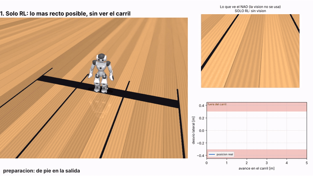
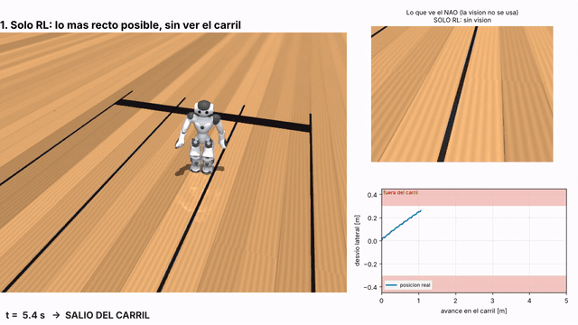
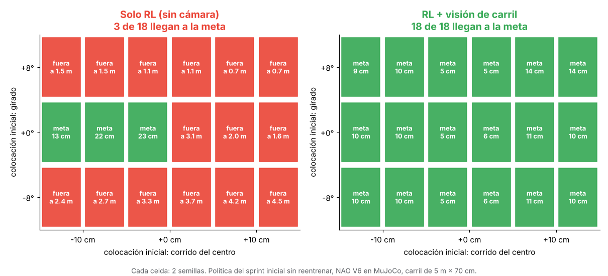
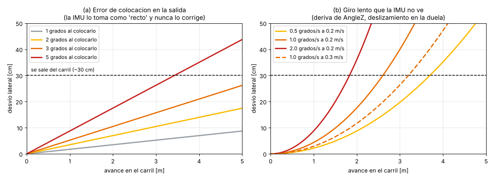
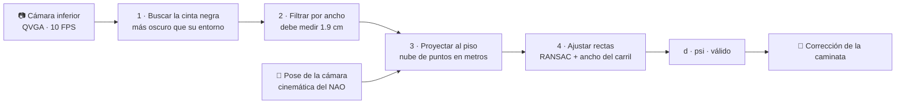
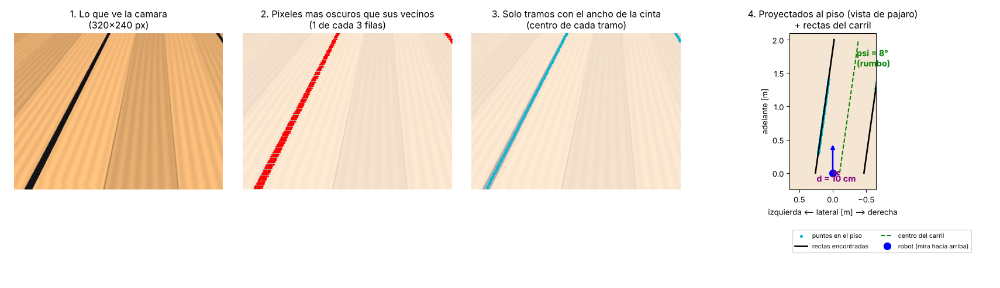
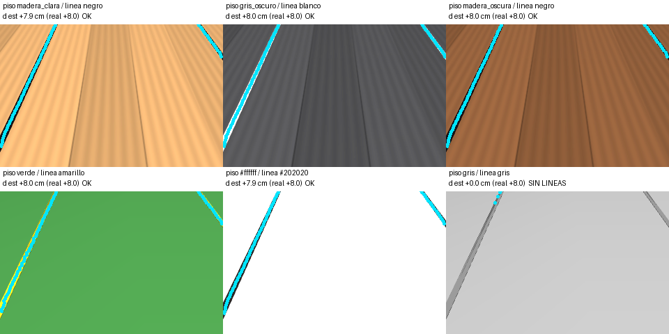
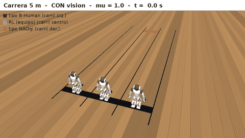
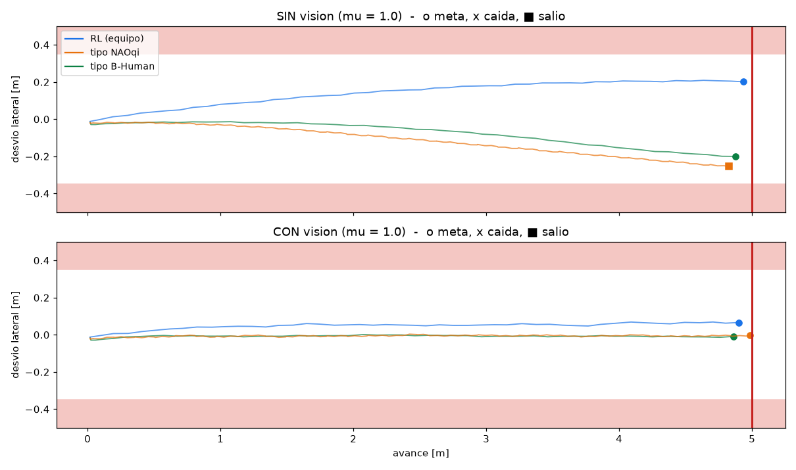

<div align="center">

# 👁️ nao_linea

### Visión de carril para que un NAO V6 no se salga en la Carrera Individual

**El robot mira las líneas del carril con su propia cámara, calcula dónde está y se corrige.**<br>
*Copa NAO CCM MX 2026 · carril de 5 m × 70 cm · 3 de noviembre de 2026*


</div>

---

## 🎬 La diferencia

La misma política de caminata por RL, **sin reentrenar**, colocada 8° chueca en la salida:

<table>
<tr>
<th width="50%">❌ Solo RL: camina "lo más recto posible"</th>
<th width="50%">✅ RL + visión de carril</th>
</tr>
<tr>
<td></td>
<td></td>
</tr>
<tr>
<td align="center">Se sale del carril a <b>1.05 m</b>.<br>Carrera anulada.</td>
<td align="center">Mide dónde quedó, se centra y llega a la meta.<br><b>Desvío máximo de 5 cm</b> (video acelerado ×3).</td>
</tr>
</table>

Arriba a la derecha de cada GIF se ve **lo que ve el NAO** y, en celeste, las líneas que detecta.
Video completo: [`media/demo_vision_carril.mp4`](media/demo_vision_carril.mp4).

---

## 📊 Resultado: 3 de 18 contra 18 de 18



| | Llegan a la meta | Desvío máximo (peor) | Tiempo medio en 5 m |
|:--|:--:|:--:|:--:|
| ❌ **Solo RL** | **3 / 18** | fuera del carril | 24.8 s |
| ✅ **RL + visión** | **18 / 18** | **14.5 cm** | **24.2 s** |

- Son 9 colocaciones iniciales (±10 cm, ±8°) por 2 semillas, con el NAO V6 en MuJoCo.
- Incluso con la salida **perfectamente centrada**, sin cámara se salió en 1 de 2 corridas.
- Detalle: [`resultados/lazo_cerrado.md`](resultados/lazo_cerrado.md).

---

## 🤔 ¿Por qué no basta con entrenar al robot para que vaya recto?

Porque **la IMU solo sabe cuánto ha girado desde que arrancó, no dónde están las líneas.**



- **El "recto" del robot es el rumbo con el que sale.** Si se coloca **3° chueco**, en 5 m se desvía
  **26 cm**, casi todo el margen, y la IMU nunca lo nota.
- **La posición lateral no se mide.** Ni la colocación corrida del centro, ni el deslizamiento de los
  pies en la duela, ni la deriva del propio sensor de giro.
- **El reglamento no perdona.** Un solo intento, y salir del carril anula la carrera.

> **La visión no reemplaza al RL, lo completa.** El RL aprende a caminar rápido y recto; la cámara
> corrige lo que la IMU no puede ver. Con eso se le puede pedir más velocidad al RL sin arriesgar la
> carrera.

---

## 🔍 Cómo funciona





**En pocas palabras:** se arma una nube de puntos con la cinta negra, se pasa al piso para quitar la
perspectiva, se ajustan las rectas del carril, y de ahí sale qué tan corrido (`d`) y qué tan girado
(`psi`) va el robot.

En el ejemplo de la figura, el robot está **10 cm a la izquierda y girado 8°**, y la visión estima
**10.3 cm y 8.0°**.

---

## 🎯 Precisión y 🦾 factibilidad en el NAO

<table>
<tr><td valign="top" width="50%">

**Precisión (simulación, 1.5° de error de pose)**

| Condición | σ lateral | σ rumbo |
|:--|:--:|:--:|
| Normal | 1.6 cm | 1.2° |
| 🌑 Poca luz | 1.6 cm | 1.1° |
| ✨ Reflejos | 1.7 cm | 1.3° |
| 🩹 Cinta gastada | 1.6 cm | 1.2° |
| 🤖 Robot vecino tapando | 4.8 cm | 4.1° |

100 % de mediciones válidas.
Detalle: [`resultados/modelo_error.md`](resultados/modelo_error.md).

</td><td valign="top" width="50%">

**¿Se puede montar en el NAO?**

| Requisito | Cómo se cumple |
|:--|:--|
| Python 2.7, quizá sin numpy | Versión en **Python puro**: [`carril/lane_estimator_puro.py`](carril/lane_estimator_puro.py) |
| 100 ms por foto (10 FPS) | 13 ms en PC; ~40–110 ms estimados en el NAO |
| Cámara del NAO | Inferior, QVGA, RGB, 10 FPS |
| Sin sensores nuevos | Pose de la cámara por cinemática |
| Reglamento | Permitido (sección 3.2.3) |

⚠️ A verificar en el robot real.

</td></tr>
</table>

---

## 🚀 Pruébalo

Requiere Python 3.12 y [uv](https://docs.astral.sh/uv/getting-started/installation/).

```bash
uv sync
uv run python demo/run_demo.py --live
```

Se abren el visor 3D y la ventana **"Lo que ve el NAO"**, con un panel para repetir corridas sin
cerrar nada:

| Control | Qué hace |
|:--|:--|
| 🎚️ **Inicio: corrido [cm]** | Dónde coloca el capitán al robot (+ izquierda, − derecha) |
| 🎚️ **Inicio: girado [grados]** | Qué tan chueco lo coloca |
| ☑️ **Visión de carril** | Con visión se corrige; sin visión camina a ciegas |
| ▶️ **Correr / Reiniciar** | Lanza la corrida (o la reinicia) |
| ⏹️ **Detener** | Para la corrida |
| 🎨 **Piso ▼ / Línea ▼ + Aplicar colores** | Listas desplegables para cambiar los colores de la pista |

**Para mostrarlo:** pon corrido 15 y girado −10, desmarca la visión y presiona Correr: se sale. Marca la
visión y vuelve a correr: mide dónde quedó, se centra y llega.

### 🎨 Cambiar los colores de la pista

Hay tres formas, de la más rápida a la más permanente:

1. **En el panel:** elige el color en las listas desplegables **Piso ▼** y **Línea ▼** y presiona
   **Aplicar colores**.
2. **En la terminal:**
   ```bash
   uv run python demo/run_demo.py --live --piso gris_oscuro --linea blanco
   uv run python demo/run_demo.py --live --piso "#3a2a1a" --linea "#f5f5f5" --sin-veta
   ```
3. **En el archivo [`demo/pista.yaml`](demo/pista.yaml)**, que es lo que se usa por defecto:
   ```yaml
   piso: madera_clara     # color base del piso
   veta: true             # tablas y veta de madera; false = piso liso
   linea: negro           # color de las líneas del carril
   meta: rojo             # color de la franja de meta
   ```

**Colores con nombre:**
- **Pisos:** `madera_clara`, `madera_oscura`, `duela_roja`, `gris`, `gris_oscuro`, `blanco`, `negro`, `verde`, `azul`.
- **Líneas:** `negro`, `blanco`, `amarillo`, `rojo`, `azul`, `verde`, `gris`.

También acepta cualquier código `#rrggbb`. La pista se regenera sola al correr la demo.



La visión decide sola si busca líneas **más oscuras** o **más claras** que el piso. En las combinaciones
de la imagen, el robot está 8 cm corrido y la visión lo estima con unos 0.1 cm de error. Si la línea y
el piso se parecen demasiado (abajo a la derecha, gris sobre gris), no encuentra las líneas: la demo
avisa, porque en una pista real tampoco se verían.

<details>
<summary><b>Otros comandos</b></summary>

```bash
uv run python demo/run_demo.py --live --inicio-d 12 --inicio-psi 8 --sin-camara   # sin la ventana de la cámara
uv run python demo/run_demo.py --video demo.mp4 --inicio-psi 8                    # video comparativo (3-5 min)
uv run python demo/build_scene.py                                                 # regenerar la pista
```

- **macOS:** usar `uv run mjpython demo/run_demo.py --live`.
- **Linux sin pantalla:** anteponer `MUJOCO_GL=egl` (u `osmesa`).

</details>

<details>
<summary><b>Qué hay en este repositorio</b></summary>

| Ruta | Qué es |
|:--|:--|
| `carril/` | Visión de carril: modelo de cámara, estimador (numpy y Python puro), filtro visión + odometría y controlador |
| `demo/build_scene.py` | Pista de 5 m × 70 cm en MuJoCo (piso, líneas, meta) y NAO V6 con su cámara inferior |
| `demo/pista.yaml` | Colores de la pista: piso, veta, línea y meta |
| `demo/run_demo.py` | Demo interactiva con panel y video comparativo |
| `demo/caminatas/` | Caminatas tipo NAOqi y tipo B-Human, cinemática inversa, simulador del carril, benchmark y video de la carrera |
| `rl/` | **RL propio en GPU** (MJX + Brax): entorno del NAO, entrenamiento, evaluación de robustez, cola nocturna; `rl/politicas/` con las políticas elegidas |
| [`bitacora.txt`](bitacora.txt) | Registro de decisiones, errores y resultados (base para el paper) |
| `robot/` | Kit para el NAO real: diagnóstico, medición de la visión, grabación de fotos y caminata ([`robot/LUNES.md`](robot/LUNES.md)) |
| `src/`, `checkpoints/`, `assets/` | Caminata por RL (PPO) y modelo del NAO V6, del proyecto [CamiloGomezB/NAO](https://github.com/CamiloGomezB/NAO) |
| `media/`, `img/`, `resultados/` | GIFs, video, figuras y resultados de esta página |
| [`DEMO.md`](DEMO.md) | Guía detallada de la demo |

</details>

---

## 🏁 Las 3 caminatas: ¿cuál es más rápida?

En el mismo carril del simulador se comparan **la caminata por RL del equipo** con dos caminatas clásicas
reimplementadas aquí: una **tipo NAOqi** (la que trae el robot de fábrica) y una **tipo B-Human** (la del
equipo campeón de RoboCup, base de PenaltyStack).

<div align="center">

<br><sub>Cada robot va en su carril, con visión. Video completo: <a href="media/carrera_3_caminatas.mp4"><code>media/carrera_3_caminatas.mp4</code></a> (acelerado ×3).</sub>
</div>

| Caminata | Cómo funciona | Velocidad | Llega con visión | Llega sin visión | Tiempo en 5 m (con visión) |
|:--|:--|:--:|:--:|:--:|:--:|
| 🟢 **tipo B-Human** | Pasos cortos y rápidos (250 ms), giroscopio y FSR | **0.30 m/s** | **25 / 25** | 15 / 25 | **16.2 – 18.3 s** |
| 🔵 **RL (equipo)** | Política PPO entrenada a 0.2 m/s | 0.20 m/s | **25 / 25** | 15 / 25 | 24.2 – 24.3 s |
| 🟠 **tipo NAOqi** | Pasos planeados + control del ZMP (pasos de 500 ms) | 0.10 m/s | **25 / 25** | 14 / 25 | 45.3 – 49.9 s |

- **150 corridas:** 3 caminatas × con/sin visión × 5 fricciones (μ = 0.4, 0.6, 0.8, 1.0, 1.2) × 5 salidas
  con error de colocación aleatorio (el mismo para las tres).
- **Ninguna se cayó.** Sin visión, las tres se salen del carril en ~40 % de las corridas. **Con visión,
  todas llegan siempre**, con cualquier fricción.
- **Fricción:** el RL se entrenó con **μ = 1.0 sin variarla**. Aun así, aguantó todo el rango; lo que cambia
  con la fricción es hacia dónde se desvía, no si se cae.
- Aquí la visión es **simulada con el error medido** (σ = 1.6 cm y 1.2°, a 10 Hz) para que el benchmark
  sea rápido. La cámara completa ya se probó en lazo cerrado arriba.
- Tabla completa por fricción: [`resultados/benchmark/benchmark.md`](resultados/benchmark/benchmark.md).



> ⚠️ **Ojo:** las caminatas clásicas son **reimplementaciones propias** del esquema de cada una, no el código
> original, y en el simulador los motores son ideales. Lo que sí coincide con el robot real es el orden:
> B-Human anda ~0.3 m/s y NAOqi ~0.1 m/s en un NAO de verdad.

<details>
<summary><b>Cómo correrlo</b></summary>

```powershell
uv run python -m demo.caminatas.carrera_vivo                            # los 3 NAOs a la vez en el visor
uv run python -m demo.caminatas.carrera_vivo --sin-vision --mu 0.6      # sin vision, piso resbaloso
uv run python -m demo.caminatas.simular --caminata bhuman --vivo        # ver una sola caminata
uv run python -m demo.caminatas.simular --caminata naoqi --mu 0.6       # con otra friccion
uv run python -m demo.caminatas.benchmark --rapido                      # benchmark corto (~1 min)
uv run python -m demo.caminatas.benchmark                               # completo (~6 min)
uv run python -m demo.caminatas.video_carrera --gif media/carrera.gif   # video de la carrera
```

</details>

---

## 🧠 RL propio en GPU: un NAO que camina a 0.3 m/s

Además de usar la caminata RL del equipo, entrenamos **nuestra propia política desde cero** en una GPU de
casa (RTX 5060, 8 GB) con **MuJoCo MJX + Brax PPO** dentro de WSL2: miles de NAOs simulados a la vez.

| | |
|:--|:--|
| **Robot** | NAO V6 (modelo de B-Human / PenaltyStack): 13 motores (piernas + hombros), acción cada **24 ms** |
| **Qué ve** | Solo sensores del NAO real: giroscopio, inclinación, ángulos y velocidades de motores, **error de rumbo** (en la carrera lo da la visión) |
| **Velocidad** | ~15 600 pasos de entrenamiento/s · una generación de 60 M de pasos ≈ **56 min** |
| **Truco clave** | Escena de entrenamiento con choques solo pies–piso: **36× más rápida** con la misma física |

### Generaciones (cada una cambia una sola cosa)

| Gen | Cambio | Tiempo en 5 m | Desvío lateral | Metas en condiciones **no vistas** |
|:--|:--|:--:|:--:|:--:|
| v01 | Base, mundo ideal | 19.1 s | 233 cm | 23/80 (29 %) |
| **v01b** | + la política ve el **error de rumbo** | **16.4 s** | **12 cm** | 66/80 (83 %) |
| v01c | + castigo a la postura de cadera | 17.2 s | 60 cm | **71/80 (89 %)** |
| v02 | + fricción, masas y kp al azar | *evaluando* | | |
| v03 | + motor débil y retraso | *entrenando* | | |

- **Condiciones no vistas** (8 carreras de 5 m cada una, sin visión): fricción 0.2/0.5/1.5, motores 30 % más blandos,
  un motor al 70/40 %, retraso de 24/72 ms, empujones de 0.25/0.45 m/s. Medido con [`rl/evaluar.py`](rl/evaluar.py).
- **v01b ya iguala a la caminata tipo B-Human** (16.2 s) y es un tercio más rápida que la RL anterior del equipo (24.3 s).
- Pendiente: ninguna aguanta **72 ms de retraso** (lo ataca v03) y la v02 parece dar **pasos muy cortos sin levantar bien
  los pies** (por revisar en video; el premio de fase de pies está calibrado para otro robot).
- Todo el proceso, incluidos los errores, está en [`bitacora.txt`](bitacora.txt).

<details>
<summary><b>Cómo se entrena (resumen)</b></summary>

```bash
# en WSL2, con MuJoCo Playground instalado (ver bitacora.txt, entradas 2-4)
PY=~/nao_rl/mujoco_playground/.venv/bin/python
$PY entrenar.py nao_v01b --pasos 60000000          # una generacion (~1 h)
$PY evaluar.py runs/nao_v01b_s0_XXXX                # 11 condiciones x 8 carreras
bash cola_noche.sh noches/noche_01.txt              # cola nocturna (~8 h) + resumen automatico
```

Políticas elegidas (cargables con `ver_politica.py` / `evaluar.py`): [`rl/politicas/`](rl/politicas).

</details>

---

## ⚖️ Limitaciones

- **Todo está medido en simulación.** La duela, la luz y la cinta reales serán distintas. El siguiente
  paso es medir en una pista réplica con el NAO real.
- **La demo corrige el rumbo con un truco.** Le suma una señal falsa al giroscopio de la política, y eso
  solo funciona con señales pequeñas; con señales grandes la política gira al revés. Lo correcto es
  **reentrenar la política para que reciba `d` y `psi`** como entradas.
- **El RL propio todavía no usa la cámara real** en su entrenamiento: ve un error de rumbo integrado del giroscopio.
  La visión simulada (ruido, 10 Hz, retraso) es la siguiente generación, y luego la prueba con la cámara del simulador.
- **Con un robot vecino tapando una línea, el error sube.** El filtro y el ancho conocido del carril lo
  amortiguan, pero hay que probarlo.

---

<div align="center">

**Proyecto principal (caminata por RL):** [CamiloGomezB/NAO](https://github.com/CamiloGomezB/NAO) · propuesta completa en la rama `fase-p-camara-carril`

</div>
