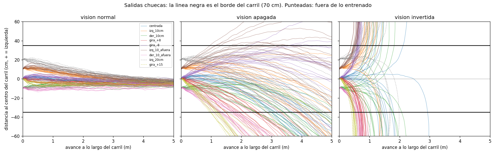
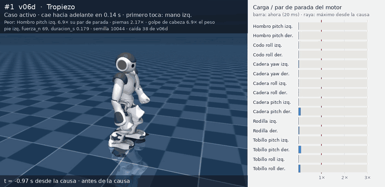
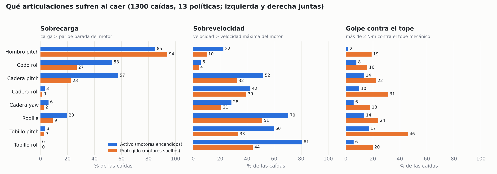
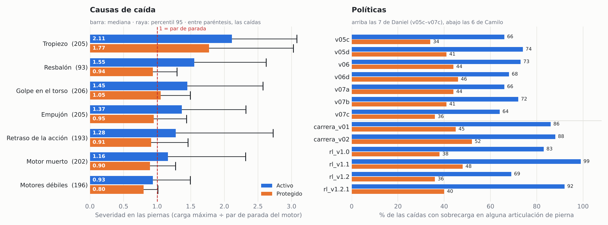
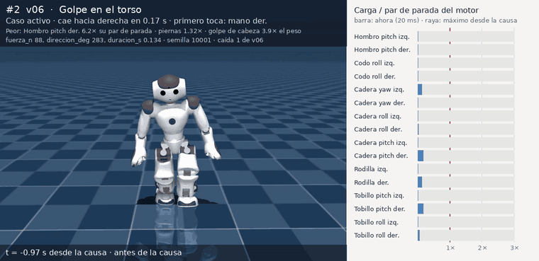
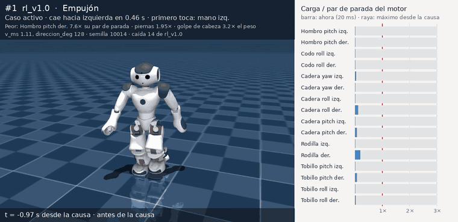

<div align="center">

# 🧠 nao_linea · rama `rl-nao-mjx`

### Caminata por RL para un NAO V6, entrenada desde cero en una GPU de casa

*Copa NAO CCM MX 2026 · Carrera Individual · carril de 5 m × 70 cm*


</div>

---

## 📌 Resumen

| | |
|:--|:--|
| **Qué es** | Una política PPO propia que hace caminar al NAO V6 recto y rápido, entrenada desde cero |
| **Dónde** | WSL2 (Ubuntu 24.04) · RTX 5060 8 GB · JAX 0.6.2 + Brax 0.14.2 + MuJoCo Playground |
| **Escala** | 4096 NAOs simulados a la vez · ~15 600 pasos/s · 60 M de pasos ≈ 56 min |
| **Mejor resultado hasta ahora** | **v06 (con visión simulada):** 5 m en **10.9 s** con los límites reales de los motores del NAO, desvío de **4–7 cm**, **0 salidas del carril** en 224 carreras con salida chueca (tasa real ≤ 1.3 %, 95 %) y **77/80** metas fuera del nominal |
| **Techo de velocidad medido** | **v05d:** 5 m en **9.4 s** a 0.6 m/s (sin visión, 18 cm de desvío) |
| **Estudio de caídas** | **1300 caídas** (13 políticas, 100 por política, 7 causas distintas) en simulación: el **hombro** y la **cadera pitch** son lo que más sufre, el **tropiezo** es la peor causa y soltar los motores no protege brazos ni cabeza. Ver [💥 Caídas](#-caídas-cómo-sufre-cada-articulación) |
| **Registro completo** | [`bitacora.txt`](bitacora.txt): cada decisión, error y fallo (base para el paper) |

---

## 🛠️ Cómo se montó

1. **WSL2 + Ubuntu 24.04** con el driver de Windows (617.14, CUDA 12) visible dentro de Linux.
2. **MuJoCo Playground** (DeepMind) clonado e instalado con `uv`. Se fija `jax[cuda12]==0.6.2`, la
   versión de su `uv.lock`: con JAX 0.11 se rompe `device_put_replicated` de Brax.
3. **Prueba del stack** con los ejemplos CartPole y G1 del Playground, antes de tocar el NAO.
4. **Modelo del NAO V6** (el mismo de B-Human / PenaltyStack) revisado en MJX con `rl/revisar_nao_mjx.py`.
5. **Escena de entrenamiento propia** (`rl/escena_mjx.py`): solo choques pie–piso.
6. **Entorno `NaoCarrera`** (`rl/nao_carrera.py`) y generaciones que cambian **una sola cosa** cada vez.

> Reglas del entorno: siempre `~/nao_rl/mujoco_playground/.venv/bin/python`, nunca `uv sync` otra vez
> (borra las librerías de NVIDIA) y `export XLA_PYTHON_CLIENT_MEM_FRACTION=0.7`.

---

## 🤖 Diseño del entorno

### Simulación

| Parámetro | Valor |
|:--|:--|
| Paso de control | **24 ms** (2 ciclos de 12 ms del NAO), 12 subpasos de física de 2 ms |
| Episodio | 1000 pasos (24 s) · comando nuevo cada ~10 s |
| Integrador / solver | `implicitfast` · Newton, 4 iteraciones, 8 de búsqueda de línea |
| Contacto | cono piramidal · fricción 1.0 / 0.005 / 0.0001 · solref (0.02, 1) · solimp (0.9, 0.95, 0.001) |
| Motores | posición, kp 40, kv 0.5, torque ±5 N·m |
| Robot | 5.36 kg · pie de 15 × 7.5 × 3 cm · HipYawPitch acoplada por una restricción de igualdad |

### Acción

**13 motores**: las dos piernas (HipYawPitch compartida) y los hombros, que ayudan al equilibrio.
**15 con codos** (`codos=True`, desde v01e): + `LElbowRoll` y `RElbowRoll`.
La política da un desplazamiento alrededor de la postura inicial.

**Motores reales** (`motores_reales=True`, desde v05a): en cada subpaso de 2 ms el torque máximo de cada motor es
`par_max · (1 − |ω| / vel_max)`, la recta de un motor DC: a su velocidad sin carga ya no da fuerza.

| Articulación | Velocidad máxima | Torque máximo |
|:--|:--:|:--:|
| HipYawPitch, HipRoll, AnkleRoll | 4.53 rad/s | ±5 N·m (modelo) |
| HipPitch, KneePitch, AnklePitch | 6.96 rad/s | ±5 N·m (modelo) |
| ShoulderPitch | 7.46 rad/s | 2.15 N·m |
| ElbowRoll | 6.47 rad/s | 2.48 N·m |

Datos de las tablas del fabricante (V4/V5; para el V6 exacto no hay hoja de datos, ±10 %). Ver `bitacora.txt` [34].

### Observación (actor)

Solo lo que da el NAO real; **nada de velocidad lineal ni posición global**.

| Señal | Tamaño |
|:--|:--:|
| Giroscopio | 3 |
| Gravedad proyectada (inclinación) | 3 |
| Ángulos de motores (respecto a la postura base) | 13 |
| Velocidades de motores | 13 |
| Acción anterior | 13 |
| Comando (vx, giro) | 2 |
| Fase de la marcha | 2 |
| **Error de rumbo** (v01b – v05d) | 1 |
| **Visión: ψ y d** (desde v06, reemplaza al error de rumbo) | 2 |

- Total: 49 valores (50 con el rumbo; 56 con codos), **× 3 pasos de historia**. Giroscopio,
  inclinación, ángulos y velocidades llevan ruido de sensor.
- El **error de rumbo** es el rumbo deseado (integra el giro pedido) menos el rumbo estimado (integra el
  giroscopio con una deriva de 0.005 rad/s), recortado a ±0.5 rad. Así la política aprende a corregir
  hacia una referencia que luego puede venir de otra fuente.
- La **visión simulada** (desde v06) no renderiza imágenes: es un *modelo de error* de la cámara. Toma la
  verdad del simulador (ψ = ángulo con el carril, d = distancia al centro, + = izquierda) y le agrega lo que
  tendría la cámara real:

  | Efecto | Valor |
  |:--|:--|
  | Ruido por cuadro | σ 1.6 cm en d, 1.2° en ψ (medido con el estimador real del equipo) |
  | Frecuencia | un cuadro cada 4 pasos (~10 Hz) |
  | Retraso | se publica el cuadro anterior (~130 ms efectivos) |
  | Cuadros perdidos | 5 % (se mantiene la medición anterior) |
  | Salida chueca al entrenar | d0 ±10 cm, ψ0 ±8° |


### Crítico (privilegiado)

Ve además las señales sin ruido y lo que el robot real no puede medir: velocidad lineal del torso,
altura del torso y de cada pie, tiempo en el aire, fricción del piso, empujón y retraso actual; desde v06, también
d y ψ reales. Red del actor 128×3 y del crítico 256×3.

### Recompensa

| Término | Escala | Para qué |
|:--|:--:|:--|
| `seguir_vel` | + | Ir a la velocidad pedida y sin moverse de lado (σ = 0.025) |
| `seguir_giro` | + | Girar lo pedido (σ = 0.1) |
| `seguir_rumbo` | +1.0 | Mantener el rumbo de salida (σ = 0.03 rad², ~10°), desde v01b |
| `seguir_carril` | +1.0 | Ir por el centro del carril (d real, σ = 0.01 m², ~10 cm), desde v06 |
| `tiempo_aire` | + | Pasos con fase de vuelo |
| `fase_pies` | + | Que el pie suba según una curva de 3 cm. Tolerancia `sigma_pies` 0.01 (del G1) → **0.0005 desde v01d** |
| `vel_z`, `giro_xy`, `orientacion` | − | Torso estable y derecho |
| `pies_resbalan` | − | Que el pie apoyado no patine |
| `pies_juntos` | − | Separación mínima de 8 cm (el V6 tiene ~3 cm entre piernas y se pisa) |
| `postura_cadera` | −0.5 | Castigo a girar o abrir la cadera, desde v01c |
| `cambio_accion`, `energia`, `limites` | − | Movimientos suaves y dentro de rango |
| `quieto` | − | No quedarse parado si se pide avanzar |
| `caida` | −100 | Termina el episodio |

**Caída:** torso por debajo de 20 cm o inclinado demasiado.

### Robustez (domain randomization)

| Perturbación | Rango | Desde |
|:--|:--|:--:|
| Fricción (piso **y** pies, porque MuJoCo usa el máximo de los dos) | 0.3 – 1.2 | v02d, v03m, v04 |
| Masa de cada pieza | ±10 % | v02d, v03m, v04 |
| kp de cada motor | ×0.8 – 1.2 | v02d, v03m, v04 |
| Retraso de la acción | 0 – 2 ciclos (0 – 48 ms) | v02r y todas las v03 / v04 |
| Empujones al torso | 0.05 – 0.3 m/s cada 3 – 6 s | v03e, v04 |
| Un motor de pierna al azar "caliente" (menos torque máximo) | 50 – 100 % | implementado, sin usar todavía |

---

## 🧭 Decisiones clave

| Decisión | Por qué |
|:--|:--|
| Escena de entrenamiento solo con choques pie–piso | Con los 17 geoms: 9 908 pasos de física/s y sin memoria; solo pies: **360 952/s (36×)** con la misma dinámica de caminata |
| Velocidad: 0.3 m/s hasta v05a, luego 0.4 → 0.5 m/s (0.6 para medir el techo) | Primero robustez a la velocidad tipo B-Human; después subir por etapas sin perderla |
| Límites reales de los motores antes de subir velocidad | Sin ellos, la política podía usar movimientos que el NAO no puede hacer (v04 se caía enseguida con ellos) |
| Cada etapa arranca de la anterior (`--desde`) | Un currículo: subir 0.1 m/s desde una caminata que ya funciona cuesta ~1 h; desde cero sería mucho más |
| Trasplante de pesos por nombre de entrada | Al agregar la visión, la red conserva todo lo aprendido; las entradas nuevas arrancan con peso 0 |
| Visión como modelo de error, no como imágenes | El método de cámara del equipo aún no está definido; el ruido, la frecuencia y el retraso sí se pueden medir |
| Los hombros entran en la acción | Los brazos ayudan al equilibrio |
| Actor–crítico asimétrico | El crítico aprende mejor con información privilegiada; el actor queda desplegable en el NAO |
| Ruido en generaciones aparte | Si se mete todo junto y falla, no se sabe qué lo rompió |
| Política cada 24 ms | Múltiplo del ciclo de 12 ms del NAO |
| Guardar checkpoint en cada evaluación | Si algo falla de noche no se pierde la corrida |
| Evaluación con condiciones vistas / no vistas | Para medir generalización y no solo lo que se entrenó |

---

## 📈 Generaciones

Cada una cambia **una sola cosa** respecto a su base (`GENERACIONES` en [`rl/entrenar.py`](rl/entrenar.py)).
Todas a 60 M pasos (~1 h) y semilla 0, salvo donde se indica. Desde v05a cada etapa arranca de la política
anterior (`--desde`) en vez de empezar desde cero.

```
v01 ─ v01b (rumbo) ─ v01c (cadera) ─ v01d (pies) ─┬─ v01e (codos)
                                                  ├─ v02d (mundo al azar)
                                                  └─ v02r (retraso) ─┬─ v03c (codos)
                                                                     ├─ v03m (mundo)
                                                                     ├─ v03e (empujones)
                                                                     └─ v04 (las tres, 120 M)
                                                                          │  (semillas 1 y 2; 60 M de control)
                                                                          │
  día 3:  v04 ─ v05a (motores reales) ─ v05b (0.4 m/s) ─ v05c (0.5 m/s) ─┬─ v05d (0.6 m/s)
                                                          (3 semillas)   └─ v06 (visión, 120 M, 2 semillas)
```

| Gen | Cambio sobre su base | Hipótesis | ¿Se cumplió? |
|:--|:--|:--|:--|
| v01 | Base, mundo ideal | Camina a la velocidad pedida | Sí, pero gira ~40° al arrancar |
| v01b | + error de rumbo y `seguir_rumbo` | Deja de girar al arrancar | **Sí** (233 → 12 cm) |
| v01c | + castigo a la cadera | Deja de torcer las piernas | A medias: más robusta, menos recta |
| **v01d** | + tolerancia de `fase_pies` 0.01 → 0.0005 | Levanta los pies | **Sí**: `tiempo_aire` ×2, patina menos |
| v01e | v01d + codos | Va más recta | **Sí** (desvío 20 → 10 cm), pero cae con empujones fuertes |
| v02d | v01d + fricción, masa y kp al azar | Generaliza mejor | Poco: rumbo 8° → 5° |
| **v02r** | v01d + retraso 0–48 ms | Aguanta la latencia | **Sí**: 72 ms de retraso 0/8 → **8/8** |
| v03c | v02r + codos | Suma lo recto de v01e | **No**: se cae con motores blandos |
| v03m | v02r + mundo al azar | Menos desvío en piso resbaloso | A medias: la más rápida (16.6 s) |
| v03e | v02r + empujones | Aguanta golpes fuertes | Poco: 1/8 → 2/8 |
| **v04** | v02r + codos + mundo + empujones, 120 M | Junta lo mejor | **Sí**: la mejor en casi todo |
| v05a | v04 + motores reales | Sigue a 0.3 m/s con los motores del NAO | Sí, pero más débil (empujón 1/8, 29 cm) |
| v05b | v05a + comando hasta 0.4 m/s | ~13 s sin perder robustez | **Sí** (13.8 s, 74/80) |
| **v05c** | v05b + comando hasta 0.5 m/s | ~11 s sin perder robustez | **Sí** (11.1–11.3 s en 3 semillas, 74–75/80) |
| v05d | v05c + comando hasta 0.6 m/s | Medir el techo de velocidad | 9.4 s y sin caídas: el techo está en 0.6 m/s o más |
| **v06** | v05c + visión simulada + `seguir_carril` | Se centra sola sin perder los ~11 s | **Sí** (10.9 s, 0 salidas del carril, 2 semillas) |

> v04 rompe a propósito la regla de un cambio: sus tres cambios se midieron por separado en v03c/v03m/v03e.
> Además entrenó el doble (120 M), así que **todavía no se sabe** si es mejor por combinar o por entrenar más.
> **Respuesta de la noche 3:** v04 con 60 M ya llega a 76/80, así que la robustez viene de combinar; entrenar más
> solo mejora la rectitud. Las semillas 1 y 2 confirman la robustez (74–76/80) pero **no la rectitud** (s1 se
> desvía 47 cm): sin visión, cada semilla termina con su propio sesgo de giro.

### Resultados del día 3: velocidad y visión (11 condiciones × 8 carreras de 5 m)

| | v04 | v05a | v05b | v05c s0 | v05d | **v06 s0** | v06 s1 |
|:--|:--:|:--:|:--:|:--:|:--:|:--:|:--:|
| Motores reales / visión | no / no | sí / no | sí / no | sí / no | sí / no | **sí / sí** | sí / sí |
| Comando máximo | 0.3 | 0.3 | 0.4 | 0.5 | 0.6 | 0.5 | 0.5 |
| Tiempo en 5 m (nominal) | 17.1 s | 17.4 s | 13.8 s | 11.3 s | **9.4 s** | **10.9 s** | 11.2 s |
| Desvío lateral (nominal) | 10 cm | 29 cm | 19 cm | 10 cm | 18 cm | **7 cm** | 7 cm |
| Retraso de 72 ms | 8/8 | 8/8 | 8/8 | 7/8 | 8/8 | **8/8** | 8/8 |
| Empujón de 0.45 m/s | 4/8 | 1/8 | 2/8 | 3/8 | 4/8 | **5/8** | 4/8 |
| Metas fuera del nominal (de 80) | 76 | 73 | 74 | 74 | 76 | **77** | 76 |

Salidas del carril: v06 tiene **0/8 en las 11 condiciones** (las dos semillas); v05c, sin visión, llega a 5/8
con fricción 0.2. v05c con semillas 1 y 2 (desde el mismo v05b): 11.2 / 11.1 s, 75 / 74 de 80, 7 / 10 cm. Video de v06 s0: 5/5
carreras entre 10.5 y 12.0 s, desvío máximo medio 4.4 cm.

### Resultados de los días 1 y 2 (11 condiciones × 8 carreras de 5 m, sin visión)

| | v01 | v01b | v01d | v01e | v02r | **v04** |
|:--|:--:|:--:|:--:|:--:|:--:|:--:|
| Tiempo en 5 m (nominal) | 19.1 s | **16.4 s** | 17.1 s | 17.2 s | 17.2 s | 17.1 s |
| Desvío lateral (nominal) | 233 cm | 12 cm | 20 cm | **10 cm** | 12 cm | **10 cm** |
| Rumbo máximo (nominal) | 45.7° | 3.6° | 7.9° | 4.0° | 5.4° | **3.3°** |
| Retraso de 72 ms | 0/8 | 0/8 | 0/8 | 0/8 | 8/8 | **8/8** |
| Empujón de 0.45 m/s | 0/8 | 2/8 | **6/8** | 2/8 | 1/8 | 4/8 |
| Metas fuera del nominal (de 80) | 23 | 66 | 69 | 65 | 73 | **76** |

**Condiciones:** nominal · fricción 0.5 / 0.2 / 1.5 · kp al 70 % · un motor al 70 / 40 % · retraso de
1 / 3 ciclos · empujón de 0.25 / 0.45 m/s. Detalle de cada una en `rl/runs/<corrida>/evaluacion.csv` y en
los resúmenes `rl/runs/resumen_*.md`.

### Hallazgos del día 2 (13 de octubre)

1. **El premio de los pies estaba mal calibrado.** Con la tolerancia del G1, arrastrar el pie daba el 97 % del
   premio. Con 0.0005 da el 61 %, y el robot pasó a levantar los pies el doble y a patinar menos.
2. **Entrenar con retraso es lo que más vale para el robot real.** Con 0–48 ms al azar, la política aguanta
   72 ms sin haberlos visto, no pierde velocidad con 24 ms y además va más recta.
3. **Los codos ayudan o perjudican según la base.** Sobre v01d corrigieron el giro hacia un lado (v01e); sobre
   v02r hicieron caer al robot con motores blandos (v03c). Solos no son una mejora segura.
4. **La combinación (v04) funciona mejor que cada cambio por separado**, aunque falta separar el efecto de
   entrenar el doble.
5. **La recompensa del entrenamiento no predice lo que importa en la carrera.** v01e no mejoraba en el
   entrenamiento y en la evaluación iba la mitad de desviada: el desvío lateral no está en la recompensa.
   Siempre hay que evaluar.
6. **El tiempo no ha bajado de ~17 s** porque el comando máximo sigue en 0.3 m/s. Eso es la etapa siguiente.
7. **La debilidad que queda:** empujones fuertes (máximo 4/8) y sensibilidad a motores blandos.

### Hallazgos del día 3 (14 de octubre): **se llegó a los 11 segundos**

1. **Los motores reales fueron el cambio más duro.** Con los límites de velocidad y torque del NAO, la caminata de
   v04 se caía enseguida (recompensa 90 → 19, duración 1000 → 284). Se recuperó en ~1 h: v04 dependía de movimientos
   más rápidos de lo que el robot real puede hacer.
2. **Subir la velocidad por etapas funciona.** 0.3 → 0.4 → 0.5 m/s, cada etapa desde la anterior: 17.4 → 13.8 →
   **11.3 s** sin perder robustez (73 → 74 → 74 de 80). Al acelerar, la marcha incluso se volvió más recta (29 → 10 cm).
3. **Los 11 s son reproducibles:** 3 semillas de v05c dan 11.1–11.3 s y 74–75/80.
4. **El techo de velocidad no está en 0.5 m/s:** v05d hace 5 m en **9.4 s** a 0.6 m/s, igual de robusta (76/80).
   Queda como margen; para la carrera es más arriesgada (más brecha simulación–robot real y más desvío sin visión).
5. **La visión resuelve la rectitud.** Sin visión el desvío variaba de 10 a 47 cm entre semillas; con la cámara
   simulada (v06) queda en 4–10 cm en las 11 condiciones, con **0 salidas del carril**, y se mantienen los ~11 s.
6. **El trasplante de pesos permitió agregar la visión sin empezar de cero:** v06 arrancó desde v05c con la misma
   caminata y solo tuvo que aprender a usar d.
7. **Validación de la visión** (`rl/validar_vision.py`, ver abajo): la cámara simulada mide lo configurado y la
   política de verdad la usa. Dos hallazgos nuevos: un **sesgo estable de ~4–5 cm hacia la derecha** y que, **sin
   visión, la marcha por sí sola deriva** y se sale del carril (v06 ya no ve el rumbo del giroscopio).

### Validación de la visión de v06

`validar_vision.py` no entrena: corre 9 salidas chuecas × 16 carreras con la visión **normal**, **apagada**
(ψ = d = 0) e **invertida** (signos al revés), y revisa la cámara simulada contra la verdad del simulador.



| Chequeo | v06 s0 | v06 s1 |
|:--|:--:|:--:|
| Ruido de la cámara (d / ψ), configurado 1.60 cm / 1.20° | 1.63 cm / 1.19° | 1.63 cm / 1.19° |
| Cuadros perdidos (configurado 5 %) | 4.8 % | 4.8 % |
| Retraso efectivo (esperado ~132 ms) | 144 ms | 144 ms |
| Salidas del carril, visión normal (incluye 20 cm y 15°, no entrenadas) | **0/144** | **0/144** |
| Salidas del carril, visión apagada | 86/144 | 80/144 |
| Metas con visión invertida | 0/144 | 0/144 |

- **Garantía estadística:** 0 salidas en 224 carreras con salidas entrenadas (las dos semillas), así que la tasa
  real es **≤ 1.3 %** con 95 % de confianza (Clopper-Pearson). Vale para el mundo nominal y este modelo de cámara.
- Detalle en `rl/runs/nao_v06_s*/validacion_vision/` (`veredicto.txt`, `resumen.csv`, `sensor.json`, `sensor.png`)
  y en `bitacora.txt` [43]–[44].

---

## 💥 Caídas: cómo sufre cada articulación

Para cada política entrenada (las 13: las de este repo y las de Camilo, `CamiloGomezB/nao-v6-rl-race`) se simularon
**100 caídas**, cada una provocada por una causa distinta. Salieron **1300 caídas** de 1879 simulaciones; en 111 casos el
robot **resistió** la perturbación y no cayó. Para cada caída se midió qué carga recibió cada articulación, a qué velocidad
se movió y con qué fuerza golpeó su tope, y se marcó como **crítica** cuando pasa de lo que el motor aguanta.



*Una de las 10 peores caídas de este repo (tropiezo con `v06d`). Las barras de la derecha son la carga de cada articulación
frente a lo que su motor aguanta.*

### Cómo se simuló

| | |
|:--|:--|
| **Causas (7, rotando)** | empujón, golpe en el torso, tropiezo, resbalón, motor muerto, motores débiles, retraso |
| **Intensidad** | la perturbación sube ×1.5 hasta 3 veces; si el robot aguanta las tres, se cuenta como *resistió* |
| **Caída** | torso inclinado más de 35° o altura de la cadera bajo 0.22 m |
| **Dos casos tras caer (1.5 s)** | **activo** (el robot sigue empujando) y **protegido** (motores casi sueltos) |
| **Carga en la articulación** | fuerza externa sobre cada articulación (promedio móvil de 20 ms), contra el par de parada de su motor |
| **Crítico** | carga mayor que el par de parada (**sobrecarga**), velocidad mayor que la del motor (**sobrevelocidad**) o más de 2 N·m contra el tope (**golpe al tope**) |
| **Semillas** | `10000 + k`, fijas; el resultado no depende de cuántos procesos se usen |

### Qué le pasa a cada articulación



| Articulación | Qué le pasa | Cuándo es crítico |
|:--|:--|:--|
| **Hombro (pitch)** | Es lo primero que toca el piso: recibe **2.5–2.8× su par de parada** | Sobrecarga en **85 %** de las caídas (**94 %** con motores sueltos) |
| **Codo (roll)** | Se dobla al apoyar el cuerpo sobre la mano | Sobrecarga en **53 %** |
| **Cadera (pitch)** | Sostiene al robot cuando el torso se va hacia adelante | Sobrecarga en **57 %** |
| **Rodilla** | Se flexiona rápido al perder el equilibrio | Sobrevelocidad en **70 %** |
| **Tobillo (pitch)** | Choca con su tope al soltarse | Golpe al tope en **46 %** con motores sueltos |
| **Tobillo (roll)** | Se mueve más rápido que su motor al inclinarse de lado | Sobrevelocidad en **81 %** |
| **Cabeza** | Toca primero en **10 %** de las caídas; el golpe mediano es de **6.1× el peso** del robot | En el 5 % peor llega a ~**11×** |

**Hallazgo principal:** soltar los motores al caer **ayuda a las piernas** (la sobrecarga en una pierna baja de **77 % a
42 %**), pero **no protege los brazos ni la cabeza**, que siguen igual de cargados. Es decir, apagar todo no es una postura
protectora: falta una que recoja los brazos (ver *Siguientes pasos*).

### Qué causa pesa más y cómo se comparan las políticas



- **Tropiezo: la peor.** Cae en **0.19 s** hacia adelante, **98 %** de las veces con sobrecarga en una pierna y con la
  cabeza como primer apoyo más a menudo que con cualquier otra causa (26 % de las caídas). Le siguen el resbalón (cuando
  logra tirar al robot) y el golpe en el torso (cae en 0.24 s sobre una mano).
- **Las más suaves:** motores débiles (0.93×, se cae despacio, en ~0.7 s) y motor muerto.
- **Entre políticas:** las de este repo sobrecargan alguna pierna en **64–74 %** de las caídas (v07c es la mejor, 64 %) y
  resisten más causas (8–17 de ~155 simulaciones). Las de Camilo, en **69–99 %** (`rl_v1.2`, entrenada castigando el
  esfuerzo de los motores, es la mejor de las suyas con 69 %; `rl_v1.1` la peor con 99 %) y resisten 1–5 de ~130.
- **Ojo con la comparación:** cada política se simula con el modelo de motor con que se entrenó (las de este repo, con la
  curva par–velocidad; las de Camilo, con el tope fijo de ±5 N·m), así que parte de la diferencia viene de ahí. Con los
  mismos motores la comparación sería justa (ver *Siguientes pasos*).

Dos de las caídas más duras:





Los 10 videos de cada fuente quedan en `videos/caidas/` (no se suben a git; se regeneran con un comando).

### Qué significa para el robot real

1. **Los hombros son el punto débil.** Si el NAO se cae hacia adelante, el hombro recibe más de 2.5 veces lo que aguanta.
   Conviene probar siempre con arnés o sobre un colchón.
2. **Evitar el tropiezo** es lo que más protege: es la causa más severa y la que deja la cabeza como primer apoyo.
3. **Soltar motores al detectar la caída** reduce el daño a las piernas; para brazos y cabeza hace falta algo más.
4. Son resultados de simulación con piezas de choque aproximadas y piso rígido: sirven para **comparar** políticas y
   causas, no para predecir daños absolutos.

### Reproducirlo

```bash
uv run python -m demo.caidas --procesos 15                   # 100 caídas por política, en paralelo
uv run python -m demo.caidas --verificar results/caidas/caidas.json   # vuelve a simular y compara
uv run python -m demo.caidas_video --peores 10               # videos de las 10 peores
uv run python -m demo.caidas_tablero                         # datos de la pestaña Caídas del tablero
uv run python -m demo.caidas_figuras --gifs                  # figuras y GIF de este README
```

Resultados con comando, versiones y SHA-256 de cada política en [`results/caidas/`](results/caidas/); tablero en
[`docs/index.html`](docs/index.html); detalle en la [bitácora](bitacora.txt), entradas [58]–[59].

---

## ❌ Lo que no funcionó (y cómo se arregló)

| Problema | Causa | Solución |
|:--|:--|:--|
| `ALREADY_EXISTS` y luego `Aborted` al importar JAX | Plugins de CUDA 12 y 13 a la vez | Desinstalar el plugin cuda13 |
| JAX caía a CPU (no encontraba cuDNN) | `uv sync` borró las librerías de NVIDIA | `uv pip install jax[cuda12]==0.6.2` y no volver a correr `uv sync` |
| `device_put_replicated` roto | JAX 0.11.2 incompatible con Brax 0.14.2 | Fijar la versión del `uv.lock` |
| Escena completa lenta y sin memoria | 17 geoms con choques entre todos | Escena solo pies–piso |
| Scripts pegados con heredoc salían truncados | Límite de la terminal | Copiar los scripts desde el repo |
| v01 giraba ~40° al arrancar y torcía la pierna | No tenía ninguna referencia de rumbo; la cadera estaba libre | v01b (rumbo) y v01c (castigo de cadera). Se descartó *reward hacking*: `seguir_vel` = 914 |
| `rsync` a `/mnt/c` fallaba (chgrp, mkstemp, tiempos) | El sistema de archivos de Windows no acepta esos atributos | `cp -r`, o enlaces simbólicos de `~/nao_rl/runs` a la carpeta de Windows |
| El log de la cola nocturna llega con retraso | stdout de Python con búfer | `PYTHONUNBUFFERED=1` en `cola_noche.sh` |
| La GPU marca 0 % los primeros minutos | Compilación de XLA (3.5 – 6 min por corrida) | Es normal; se ve en `estado.txt` y en el log |
| Casi no levantaba los pies | `fase_pies` con la tolerancia del G1: arrastrar daba el 97 % del premio | v01d: tolerancia 0.0005 |
| La noche 1 se cortó a las 00:50 | WSL se apagó solo (sin `.wslconfig`); tmux murió con él | Cola reanudable + `vigilante.sh` desde una tarea de Windows |
| La v04 de la noche 2 arrancó con la configuración vieja | Dos generaciones con el mismo nombre en un `dict`: gana la última | La vieja se renombró a `nao_v04_antigua`; se revisan nombres repetidos antes de enviar |
| v03c y v03m quedaron sin evaluar | `--parar` borra la hora de inicio de la cola y el resumen solo mira las últimas horas | `resumen_manana.py --horas 6` (mejora pendiente) |
| Un error de suma en la bitácora (v01d 77/80) | Error del asistente | Corregido con una entrada nueva (son 69/80) |
| El resumen evaluó corridas cortadas y de `--prueba` (12 min perdidos cada vez) | Quedan con estado "cortado" o "terminado" | Pendiente: saltar "cortado" y que `--prueba` deje estado "prueba" |
| v05a arrancó cayéndose (duración 284) | Con motores reales, la marcha de v04 era imposible | Se dejó entrenar: se recuperó en ~1 h |
| Se lanzó la cola de la noche (v06) en vez de la de la tarde | Error al escribir el comando | No se perdió nada: se intercambió el orden ([39]) |
| La visión simulada perdía sus actualizaciones (detectado en prueba) | `_paso_vision` devolvía un dict nuevo que `step()` no usaba | Modificar `info` en el lugar |
| No se puede probar un entrenamiento completo en la sesión del asistente | 7 GB de RAM: la compilación de PPO no cabe en CPU | Pruebas del entorno en CPU y `--prueba` en la GPU |

---

## 🌗 Flujo de día y de noche

| | Día | Noche |
|:--|:--|:--|
| Duración | Ciclos de ~1 h (60 M pasos) | Cola de ~8 h |
| Qué se hace | Una generación, video, evaluación y decidir | Varias generaciones y semillas seguidas |
| Cómo | `entrenar.py` en tmux | `cola_noche.sh noches/noche_NN.txt` en tmux |
| Al terminar | `evaluar.py` y `ver_politica.py` | `resumen_manana.py` evalúa lo que falte y escribe `runs/resumen_<fecha>.md` |

- La cola sigue aunque una corrida falle, y el resultado de cada corrida queda en `estado.txt`
  (corriendo / terminado / cortado).
- **Reanudable:** si se relanza la misma lista, salta las corridas ya terminadas.
- **Vigilante:** una tarea de Windows mantiene vivo `rl/vigilante.sh`, que relanza la cola si WSL o la cola se
  mueren. Para detenerla a propósito: `bash cola_noche.sh --parar`.

---

## 📁 Archivos

| Ruta | Qué es |
|:--|:--|
| `rl/nao_carrera.py` | Entorno `NaoCarrera` (MJX): reset, step, observación, recompensas, caída y `aleatorizar()` |
| `rl/escena_mjx.py` | Escena de entrenamiento con choques solo pie–piso |
| `rl/revisar_nao_mjx.py` | Revisión del modelo del NAO en MJX (velocidad, contactos, memoria) |
| `rl/entrenar.py` | Entrenamiento PPO por generación; guarda config, progreso y checkpoints |
| `rl/evaluar.py` | Evaluación de robustez en la GPU (vmap + scan) → `evaluacion.csv` |
| `rl/ver_politica.py` | 5 carreras de 5 m con video y rumbo a los 2 s |
| `rl/validar_vision.py` | Valida la cámara simulada y que la política la usa: salidas chuecas, sabotaje e intervalos de confianza |
| `rl/cola_noche.sh` | Cola de entrenamientos (reanudable, `--parar`) |
| `rl/vigilante.sh` | Relanza la cola si se muere; lo arranca el Programador de tareas de Windows |
| `rl/logs/` | Logs de cada cola y del vigilante |
| `rl/resumen_manana.py` | Evalúa lo pendiente y escribe el resumen de la noche |
| `rl/noches/` | Listas de corridas de cada noche |
| `rl/runs/` | Solo los archivos livianos de cada corrida: `config.json`, `progreso.csv`, `evaluacion.csv` y resúmenes |
| `rl/politicas/` | Políticas elegidas: `nao_v01b_s0`, `nao_v01c_s0`, `nao_v01d_s0`, `nao_v01e_s0`, `nao_v02r_s0`, `nao_v04_s0`, `nao_v02_s9_44M`, `nao_v05c_s0`, `nao_v05d_s0` y **`nao_v06_s0`** |
| `demo/caidas.py` | Motor de caídas (7 causas, 100 por política) para las políticas de Daniel y de Camilo; en paralelo y con verificación de reproducibilidad |
| `demo/caidas_video.py` | Videos de las N peores caídas (vista 3D + barras de carga por articulación) |
| `demo/caidas_tablero.py` | Convierte los resultados en los datos de la pestaña *Caídas* del tablero |
| `demo/caidas_figuras.py` | Genera las figuras y los GIF de este README → `media/caidas/` |
| `results/caidas/` | `caidas.json` (Daniel) y `caidas_camilo.json` (Camilo), con comando, versiones y SHA-256 |
| `media/caidas/` | Figuras y GIF del estudio de caídas |
| [`docs/index.html`](docs/index.html) | Tablero (GitHub Pages) con la pestaña *Caídas* |
| [`bitacora.txt`](bitacora.txt) | Bitácora de todo el proceso |

---

## ▶️ Cómo reproducirlo

```bash
# en WSL2, con MuJoCo Playground instalado (bitacora.txt, entradas 2-4)
export XLA_PYTHON_CLIENT_MEM_FRACTION=0.7
PY=~/nao_rl/mujoco_playground/.venv/bin/python
cd ~/nao_rl

$PY revisar_nao_mjx.py                                   # revisar el modelo en MJX
$PY entrenar.py nao_v04 --prueba                         # prueba corta del pipeline (~5 min)
$PY entrenar.py nao_v04 --pasos 120000000 --semilla 0    # base robusta (~1 h 40)
$PY entrenar.py nao_v05a --desde nao_v04                  # cada etapa arranca de la anterior (~1 h)
$PY entrenar.py nao_v05b --desde nao_v05a
$PY entrenar.py nao_v05c --desde nao_v05b
$PY entrenar.py nao_v06 --desde nao_v05c --pasos 120000000   # vision (trasplante de pesos automatico)
$PY evaluar.py runs/nao_v06_s0_<fecha>                   # 11 condiciones x 8 carreras (~12 min)
$PY validar_vision.py runs/nao_v06_s0_<fecha>            # salidas chuecas + sabotaje (~4 min)
$PY ver_politica.py runs/nao_v06_s0_<fecha>              # video de 5 carreras
bash cola_noche.sh noches/noche_02.txt                   # cola + evaluacion + resumen
bash cola_noche.sh --parar                               # detenerla sin que el vigilante la relance
```

Estudio de caídas (CPU, en Windows o Ubuntu; desde la raíz del repo): ver [💥 Caídas](#reproducirlo).

---

## 🔜 Siguientes pasos

1. **Que no dependa solo de la cámara:** devolverle el rumbo del giroscopio a la observación y entrenar con apagones
   de cámara de 0.5–1 s (hoy, sin visión, la marcha deriva y se sale).
2. **Quitar el sesgo de 4–5 cm:** `seguir_carril` más estrecho (otra generación, un cambio a la vez).
3. **Visión sobre v05d** (0.6 m/s, ~9.5 s) como plan B si el robot real aguanta.
4. Empujones más fuertes en el entrenamiento (sigue siendo la debilidad: 4–5/8).
5. **Hacia el robot real:** exportar la política a numpy (Python 2.7 a bordo, sin torch), medir la latencia real y
   medir la cámara real en posiciones conocidas para reemplazar el modelo de error por números medidos.
6. **Caídas:** simular la postura protectora (brazos al pecho, motores sueltos) como tercer caso, y usar un
   mismo modelo de motor para comparar de forma justa las políticas de Daniel y de Camilo.
7. Mejoras pendientes de las herramientas: el resumen debe saltar corridas cortadas y de `--prueba`;
   `ver_politica.py` dice "(sin visión)" aunque la use; agregar el tiempo en 10 m a la evaluación.
